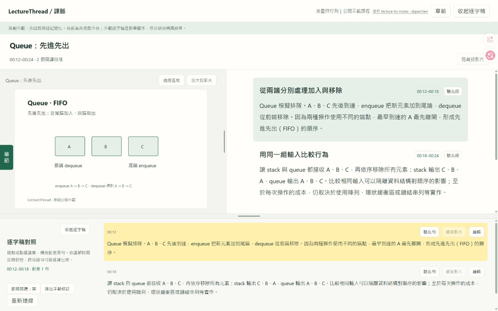

# LectureThread／課脈

串起投影片與講解，沿著老師的思路讀懂課程。

LectureThread 是一個持續開發中的課程閱讀工具：把投影片、整理後的講義、逐字稿與原始影音放在同一個閱讀介面，讓複習從閱讀開始，遇到疑問時再回到老師的原句與講解。

## 為什麼做這個專案

這個專案起於資工課程的學習需求。投影片通常只留下關鍵字與圖表，老師在課堂上補充的推導、例子和適用條件，則散落在影片裡。複習時，常常需要一邊看投影片，一邊反覆拖曳影片，才能把一個概念重新接起來。

我希望整理出能夠連貫閱讀的講義，保留老師如何提出問題、解釋原因、舉例與銜接下一個概念。同時，每一段整理都應該有回到來源的路徑，方便確認聽不清楚的術語，或重新理解某一步推理。

「課脈」想保留的，就是課程展開的脈絡。老師回到同一張投影片補充說明、加上註記，也應該留在閱讀順序裡。

## 目前的閱讀成果

*原創 stack／queue 示範畫面。左側看圖，右側讀解釋，需要核對時展開下方逐字稿。*

例如，讀到 queue 的「先進先出」時，可以同時對照圖中的加入與移除方向，再從講義段落找到對應原句。有實際課程影音時，還能直接聽這一段，或觀看原始影片，不必另外搜尋時間點。

目前閱讀器提供：

- **投影片與講義對照閱讀**：隨閱讀段落切換對應投影片，保留回頁與新增註記的順序。
- **從整理回到來源**：講義與逐字稿互相定位，可聽單句、聽段落或觀看影片；繼續播放時，跨章同步跟隨。
- **保留可核對的修訂**：原始逐字稿、校正版與人工修改分開保存，無法確認的詞與數字矛盾保留待核對標記。
- **依閱讀需要調整畫面**：調整投影片與文字的區域大小、放大投影片，或收起逐字稿；手機採上下對照。

## 試用公開示範

專案附有原創的 stack／queue 教材，包含三次投影片出現與六個閱讀段落，可以在自己的電腦上體驗對照閱讀、播放同步和人工校字。

**[開啟公開示範 →](docs/quickstart.md)**

目前入門步驟以 Windows x64／PowerShell 為準。示範不需要 GPU 或模型；首次建立 Python 環境需要網路連線。

示範共 36 秒，音訊是合成提示音，逐字稿是預先撰寫的教學腳本，沒有口語旁白或影片。它展示的是閱讀器的互動方式，不代表語音辨識或自動講義生成的品質。截圖與示範教材不包含實際課程資料。

## 目前階段與接下來的方向

LectureThread 目前是 Windows 本地研究原型，已具備閱讀介面、課程設定與公開示範，也已用本機課程驗證閱讀流程。實際課程資料保留在本機，公開原始碼不包含課程影音、模型或產生的閱讀頁。

完整本機環境可用 `lecture.cmd start "影片路徑或 YouTube 網址" --background` 依序產生逐字稿、投影片、AI 講義、閱讀頁與待核對清單，支援進度、失敗續跑及結束時停止專案 Ollama。操作見 [睡前處理一堂課](docs/overnight.md)。目前尚無網址匯入的網頁介面；本機生成的內容仍需抽查，講義與逐字稿依時間區間對照，切頁也有抽樣誤差。

接下來希望用更多課程評估本機講義品質與整夜處理耗時，補上有口語旁白與影片的公開示範，並完善從環境建立到閱讀成果的驗收流程。

## 使用與參與

- [公開示範入門](docs/quickstart.md)：環境準備、啟動與關閉服務。
- [閱讀器使用說明](docs/reader-guide.md)：播放、版面調整、逐字稿修訂與保存。
- [課程設定](docs/courses.md)：載入自己已準備好的講義、逐字稿及媒體資料。
- [睡前處理一堂課](docs/overnight.md)：從影片開始、查看進度、失敗續跑及閱讀成果。
- [開發與測試](docs/development.md) · [參與貢獻](CONTRIBUTING.md)：程式架構、開發環境與參與方式。

## 致謝與授權

LectureThread 基於 **[lecture-to-notes](https://github.com/drpwchen/lecture-to-notes)** 開發。上游作者 **drpwchen 及其貢獻者**提供影片轉錄、投影片擷取、OCR、去重、對齊與筆記匯出的重要基礎；本專案在此之上新增閱讀體驗及資工領域整理。

完整來源與貢獻區分見 [NOTICE.md](NOTICE.md)，上游版本見 [upstream-commit.txt](upstream-commit.txt)。程式採用 [MIT 授權](LICENSE)；課程素材及第三方依賴各自適用原有權利與授權。
